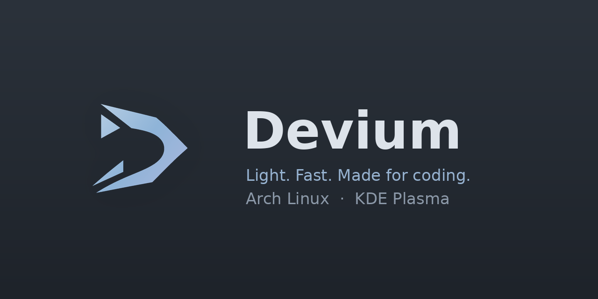
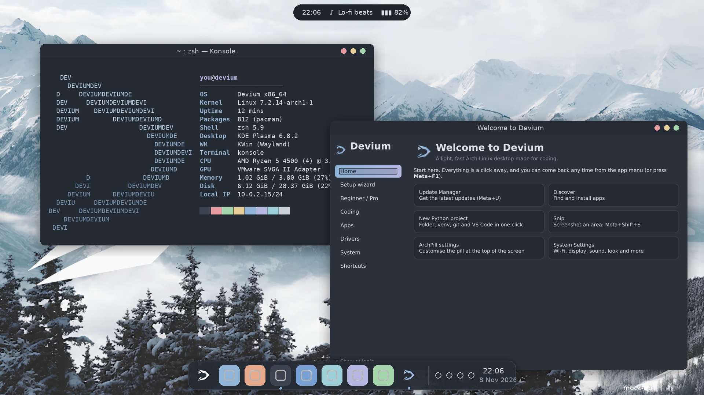
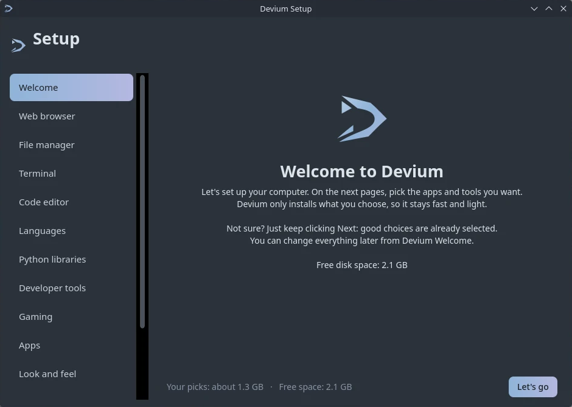
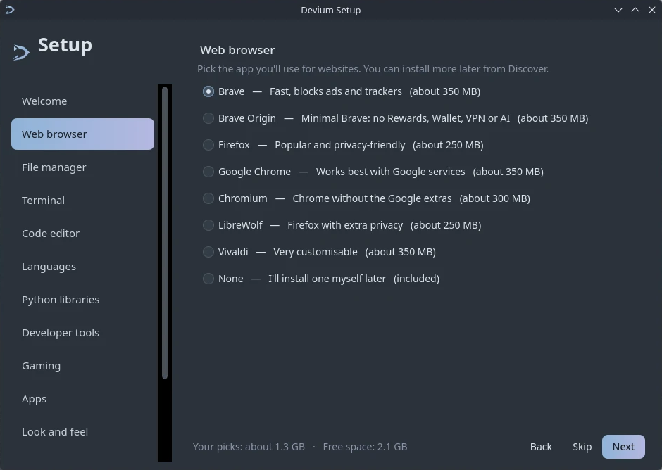
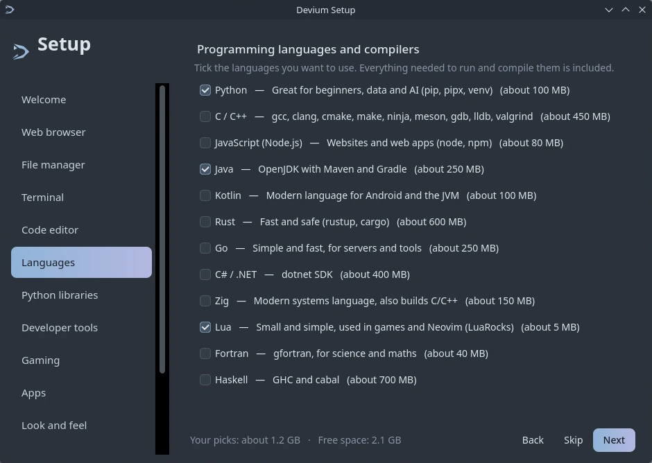
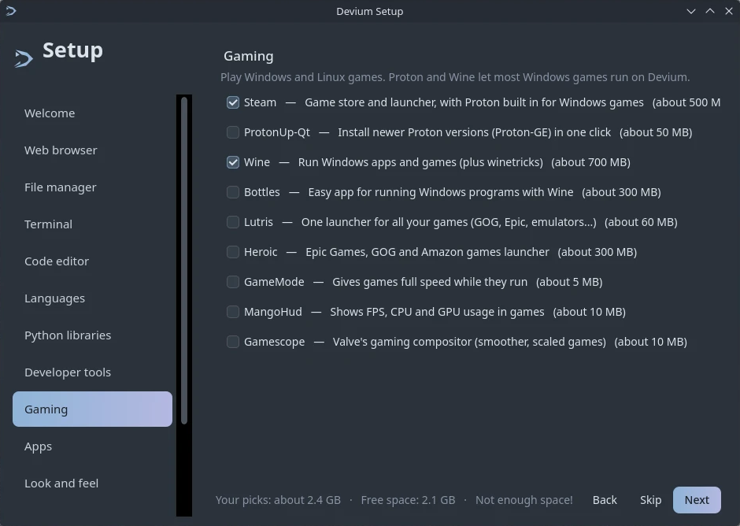
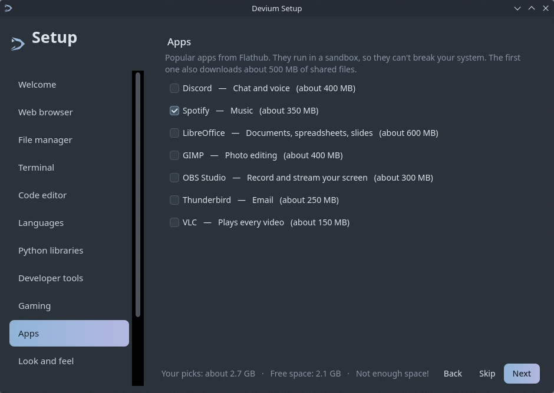
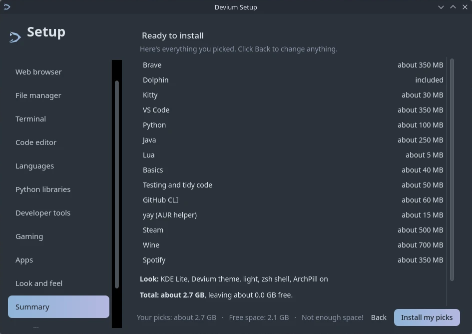
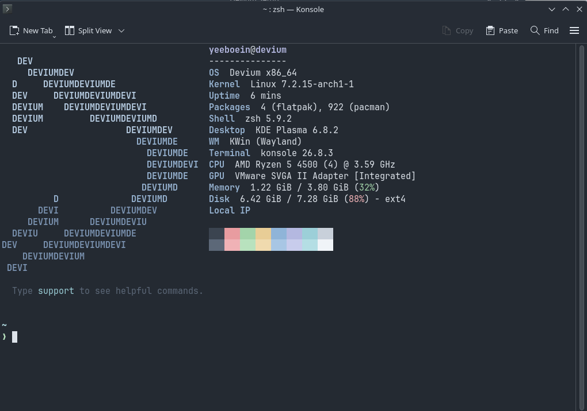

<p align="center">
  
</p>

<p align="center">
  <br>
  <b>A light, fast Arch Linux desktop made for coding: easy for beginners, nice for pros.</b>
</p>

<p align="center">
  <br>
  <sub>Desktop mock-up: mountain wallpaper, floating dock, ArchPill, fastfetch and Devium Welcome.</sub>
</p>

### Developers

<table><tr><td></td>
<td><b>Yeeboein</b><br>Owner<br><a href="https://github.com/yeeboein">github.com/yeeboein</a></td></tr></table>

Built with [ArchPill](https://github.com/yeeboein/archpill), [KDElite](https://github.com/yeeboein/kdelite),
[Arch Linux](https://archlinux.org) and [KDE Plasma](https://kde.org/plasma-desktop).

### Devium Setup: pick only what you want

Real screenshots from an installed Devium (beta7):

<p align="center">
  
  <br>
  
  <br>
  
  
</p>

<p align="center">
  <br>
  <sub>The terminal on an installed Devium: type <code>fastfetch</code> for the DEVIUM logo and system info.</sub>
</p>

More in [docs/screenshots/real](docs/screenshots/real).

---

## What's inside

| | |
|---|---|
| **Base** | Arch Linux (rolling), `linux` kernel, UEFI + BIOS boot, zram swap |
| **Desktop** | KDE Plasma (core only, no PIM/Akonadi), dark Breeze theme, bottom panel with the Devium start button |
| **Lightweight** | Baloo file indexing off, no blur, fast animations, TLP battery saver — ~550–750 MB RAM idle |
| **Devium apps** | **Welcome** (Meta+F1), **Update Manager** (Meta+U), **Snip** (Meta+Shift+S), `support` command |
| **ArchPill** | [yeeboein/archpill](https://github.com/yeeboein/archpill) preinstalled and set up on first login |
| **Apps** | Dolphin, Konsole, Kate, Spectacle (Snip), Gwenview, Okular, Ark, KCalc, System Monitor, Firefox, mpv, Discover + Flathub, Timeshift |
| **Coding** | VS Code (`code`, preconfigured for Python), git, GitHub CLI, Node.js + npm, base-devel (gcc/make), neovim, btop, ripgrep, fd, jq, starship |
| **Python** | pip, pipx, virtualenv, numpy, pandas, matplotlib, requests, flask, beautifulsoup4, pytest, black, ruff, pillow, pyyaml, rich, ipython |
| **Extras** | Firewall (ufw) on by default, printing (CUPS), driver helper, one-click Python project starter, fastfetch with the Devium logo |

### Devium apps

- **Devium Welcome** — opens at login (untick “Show at login” to stop). Install Devium, start a Python project, get popular apps from Discover, install extra drivers (NVIDIA, Broadcom
  Wi‑Fi, printers…), firewall/theme/restore-point switches and a shortcut cheat sheet.
- **Update Manager** — lists system, Flatpak and ArchPill updates, updates everything with one password
  prompt and a progress bar, takes a Timeshift restore point first (once Timeshift is set up), frees up
  disk space, and asks to restart after kernel updates. A small timer checks twice a day and shows a
  notification.
- **Snip** — Spectacle set up like the Windows Snipping Tool: **Meta+Shift+S** to select an area, draw on
  it, and it's already copied to the clipboard (and saved in `~/Pictures/Screenshots`). **Meta+Shift+R**
  records the screen.
- **`support`** — type it in a terminal to see helpful commands and what they do.

## Get the ISO

📖 **New here? Follow the step-by-step [Devium guide](docs/GUIDE.md)** (download, VM, USB, install, troubleshooting).

### Option A: download a release

Get the latest ISO from the [Releases page](https://github.com/yeeboein/devium-linux/releases).
There are two editions: **KDE Plasma** (most computers) and the lighter **Xfce** (very old laptops).

### Option B: build on GitHub (no Arch machine needed)

1. Open the repo's **Actions** tab → **Build Devium ISO** → **Run workflow** (pick this branch).
2. Wait ~30–60 minutes.
3. Download **devium-iso** from the finished run (it's a zip containing the `.iso`).

### Option C: build on Arch Linux

```bash
git clone https://github.com/yeeboein/devium-linux.git
```

```bash
cd devium-linux
```

```bash
sudo ./build.sh
```

For the lighter Xfce edition: `sudo EDITION=xfce ./build.sh`

The ISO ends up in `out/`. Packages that no longer exist in the Arch repos are skipped with a warning
instead of failing the build. Use `sudo ./build.sh --clean` to start from scratch.

## Try it in a VM

VirtualBox, VMware, GNOME Boxes or virt-manager all work.

| Setting | Value |
|---|---|
| RAM | 4 GB (2 GB minimum) |
| CPUs | 2+ |
| Disk | 30 GB (only needed to test installing) |
| Video | 128 MB, 3D acceleration on (VirtualBox: VMSVGA) |
| Firmware | UEFI or BIOS |

Boot the ISO and you land on the Plasma desktop as user **devium** (password **devium**).
If the screen stays black, choose **safe graphics** in the boot menu.

## Install to disk

Double-click **Install Devium** on the desktop (or use the Welcome app). It runs Arch's official
installer (`archinstall`) with Devium's packages pre-filled; choose the **Minimal** profile and
**NetworkManager**. At the end it downloads this repo inside the new system and runs
`devium-setup --installed`, which adds Devium's apps, branding and ArchPill.

> The installer needs internet, and this repository must be public (it clones the branch the ISO was
> built from).

## Project layout

```
build.sh                       build the ISO (wraps mkarchiso)
profile/                       archiso profile (based on Arch's releng)
  packages.x86_64              package list
  profiledef.sh                ISO name, boot modes, file permissions
  efiboot/ syslinux/           boot menus (UEFI / BIOS)
  airootfs/                    files copied into the system
    etc/xdg/                   KDE, Dolphin, Spectacle, fastfetch defaults
    etc/skel/                  new-user defaults (.bashrc, shortcuts)
    usr/local/bin/devium-*     Devium apps and scripts
    usr/lib/devium/            setup script, root helper, shared UI code
    usr/share/devium/          logos, fastfetch logo, VS Code settings
    usr/share/plasma/look-and-feel/org.devium.desktop   panel layout
.github/workflows/build-iso.yml  GitHub Actions ISO build
```

## Customising

- **Add/remove packages:** edit `profile/packages.x86_64`.
- **Panel layout:** `profile/airootfs/usr/share/plasma/look-and-feel/org.devium.desktop/contents/layouts/`.
- **Fastfetch logo:** `profile/airootfs/usr/share/devium/fastfetch-logo.txt`.
- **Wallpaper:** `profile/airootfs/usr/share/wallpapers/Devium/`.

## Notes

- VS Code is the open-source build (`code` from Arch's repos, extensions from Open VSX). Microsoft's
  build is in the AUR as `visual-studio-code-bin`.
- Discover is set up for Flatpak apps only; system updates go through the Update Manager (a full
  `pacman -Syu`), which is the safe way to update Arch.
