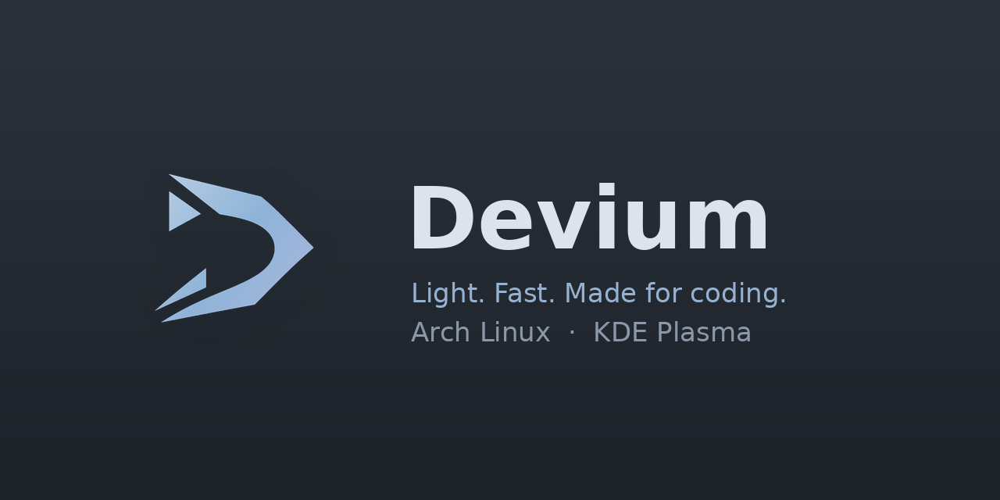
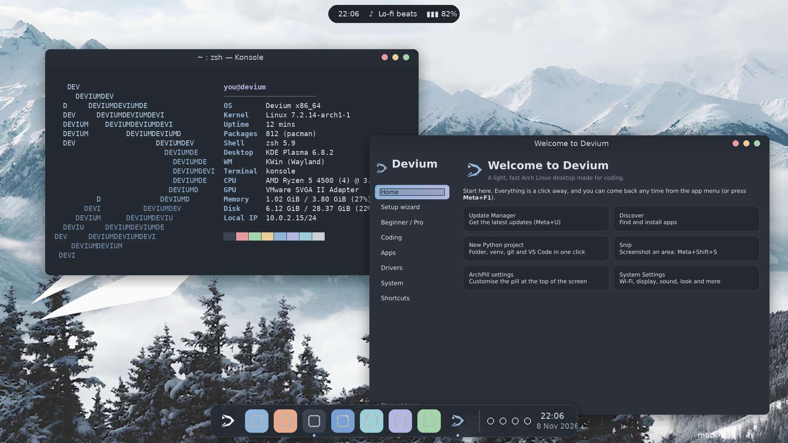
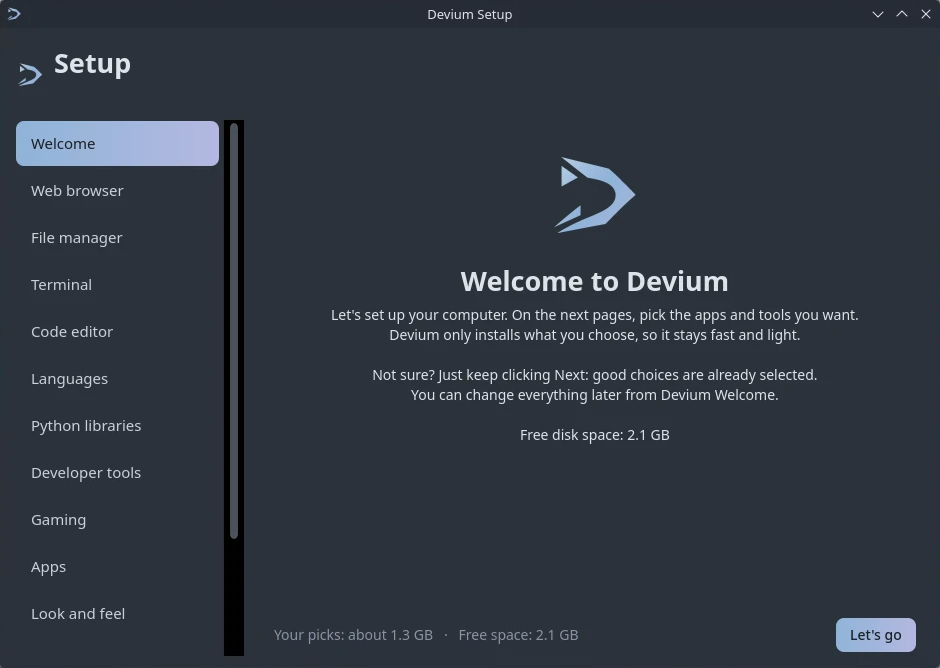
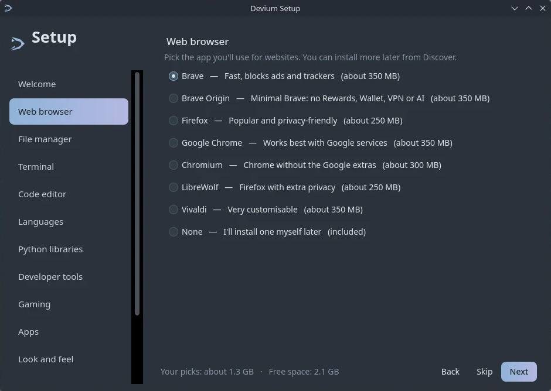
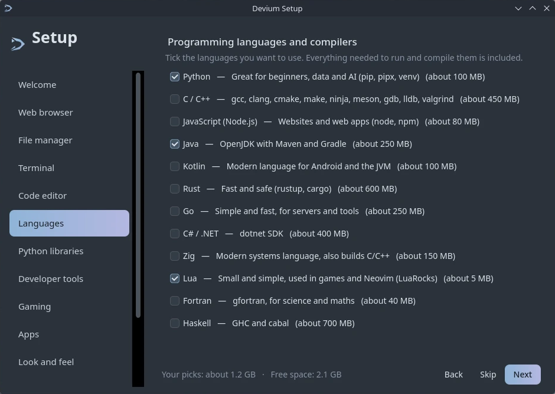
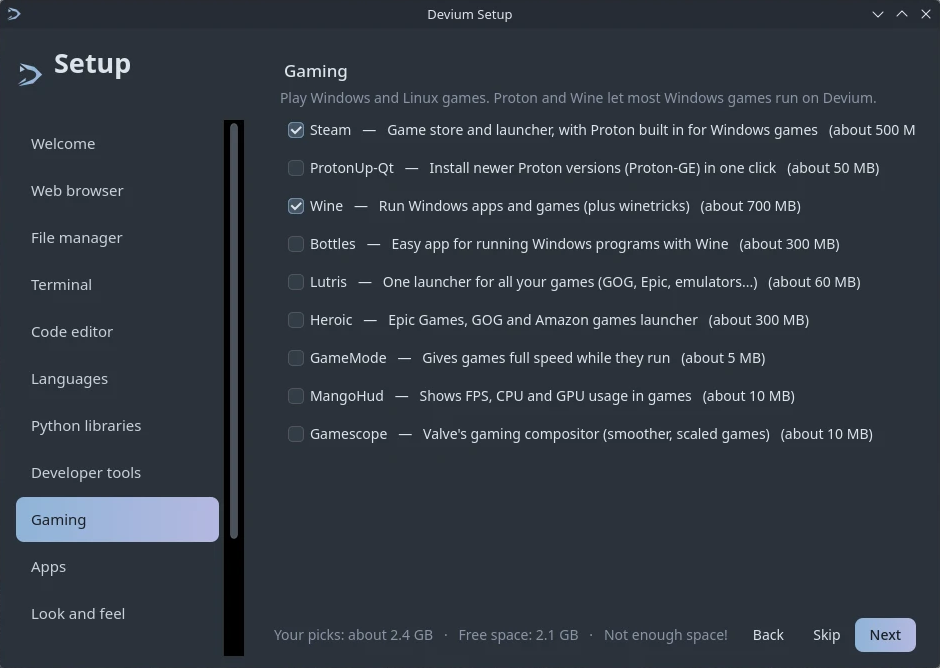
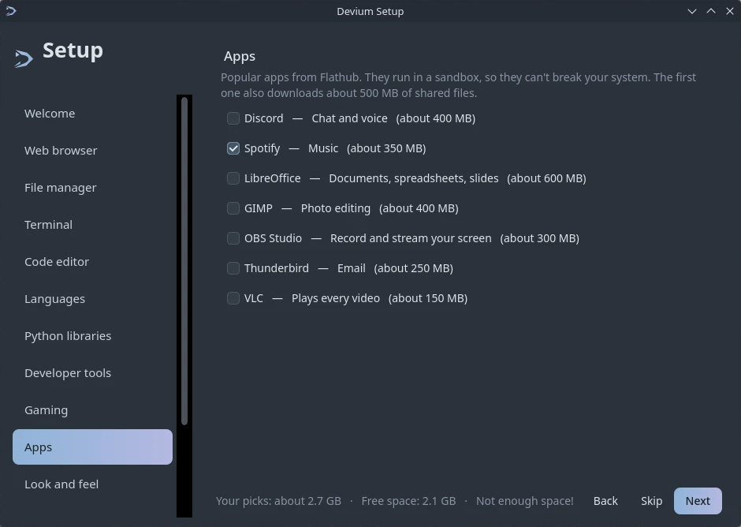
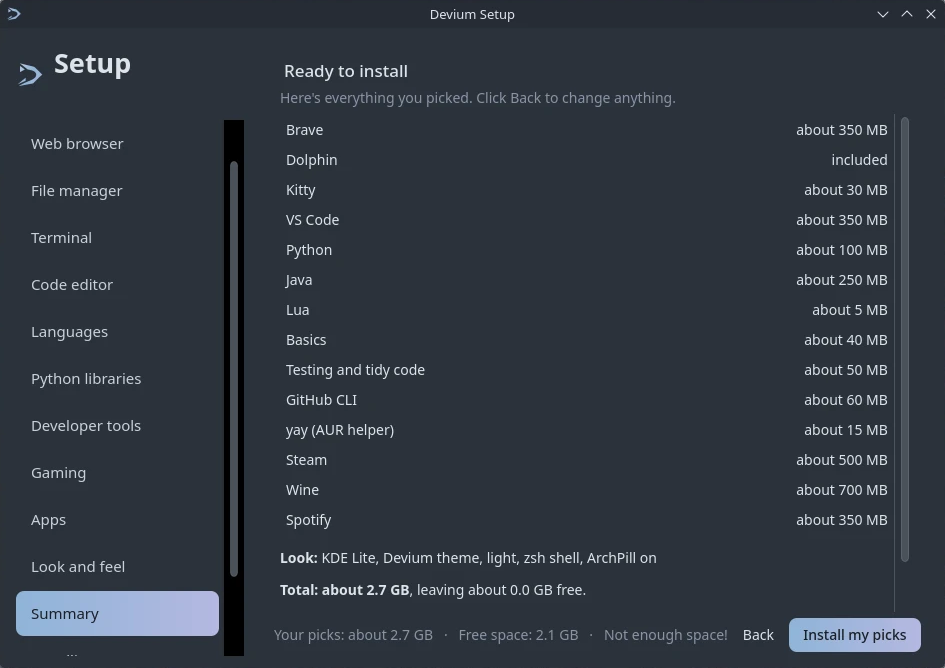
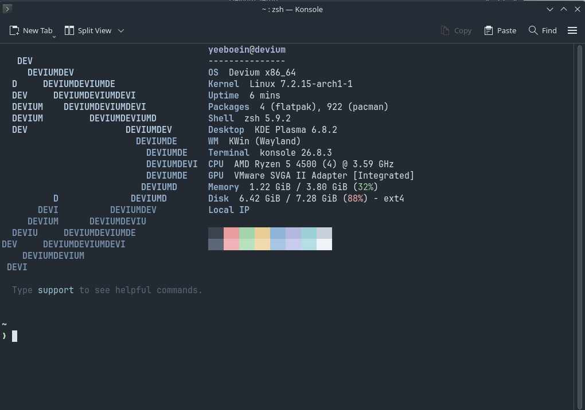

<p align="center">
  
</p>

<p align="center">
  <br>
  <b>An Arch-based distro for coding. Light enough for old laptops, easy enough for your first Linux install.</b>
</p>

<p align="center">
  <a href="https://discord.gg/YTMattgyG3"></a>
  <a href="https://github.com/yeeboein/devium-linux/releases"></a>
</p>

<p align="center">
  
</p>

## What is this?

I wanted an Arch setup I could put on any laptop and start coding on straight away, without spending
an evening configuring it. So I made Devium.

It's Arch Linux with KDE Plasma (or Xfce for really old machines), a blue-grey theme, a floating dock,
and a setup app that asks what you actually want instead of installing everything. You pick your
browser, editor, languages, games and apps, it shows you how much space each one takes, and that's
all that goes on your computer.

Devium is Arch-based and **rolling**: install once and keep updating, no reinstalling for new versions
([how updates work](docs/ROLLING.md)).

It's still in beta, so expect the odd bug. If you find one, tell me on
[Discord](https://discord.gg/YTMattgyG3) or open an issue.

## What you get

- **A real installer.** Click Install Devium, pick your disk, done. Works next to Windows too.
  Needs about 10 GB.
- **Devium Configure.** Runs after install. Browser, file manager, terminal, code editor, languages
  (Python, C/C++, Rust, Go, Java, Node...), Python libraries, dev tools, games, apps. Run it again any
  time to add or remove stuff.
- **Devium Tools** (Meta+T). App manager with size and RAM use, updates with undo, a "make it faster"
  button, low-RAM mode, battery charge limit, privacy switches, printers, Docker, Git/GitHub setup,
  help for people coming from Windows, and a way to report bugs. Also:
  - **Look:** accent colours, and a button to reset the desktop if you break it.
  - **Backup and move:** back up to a USB stick, or move your whole setup to a new PC with one file.
  - **Drivers:** NVIDIA, Broadcom Wi-Fi and fingerprint readers in one click.
  - **Health check:** disks, temperatures and battery wear. You get a warning before a disk dies.
  - **Phone link:** KDE Connect, set up with a QR code.
  - **Clean up:** finds caches, old build folders, duplicate downloads and old packages, and frees the space.
  - **Coding tools:** databases in one click, a secret guard that stops you committing passwords, `.env`
    checks, HTTPS on localhost, a public link for your local site, per-project language versions and snippets.
  - **Guest account:** let a friend use your laptop; it's wiped when they log out.
- **Devium widgets** for the desktop: sea conditions (waves, swell, water temperature, tide), weather,
  system rings, a big clock, a focus timer, your Git projects and your running dev servers.
- **Spotlight** (Meta+Space). Search apps, settings and files, do quick maths and unit conversions,
  or type `> command` to run something.
- **[ArchPill](https://github.com/yeeboein/archpill)** if you want it: a little pill at the top of the
  screen with the time, music, volume and battery, and a control centre when you click it.
- **Linux Magnify** if you want a macOS-style dock where the icons grow under your mouse.
- **`support`** in the terminal lists about 100 useful commands. `support fix` checks for common
  problems and fixes what it can, and `support learn` teaches you the terminal in 10 short lessons.
- **`devium-new-project`** starts a Python, web, Node, Flask, Rust, Go, C, C++, Java or Discord bot
  project with Git already set up. Devium Tools also shows what's running on which port, and `support dev`
  checks your whole coding setup.
- Small touches: Devium icon pack, light and dark themes, disk encryption option, Irish/Spanish/
  French/German/Hungarian in the Devium apps, and a fastfetch logo made out of the word DEVIUM.

## Screenshots

From a real install:

<p align="center">
  
  <br>
  
  <br>
  
  
</p>

<p align="center">
  
</p>

More in [docs/screenshots/real](docs/screenshots/real).

## Download

**Latest: beta18.5** ([what's new](https://github.com/yeeboein/devium-linux/releases/tag/beta18.5))

- **[Devium KDE Plasma (beta18.5)](https://github.com/yeeboein/devium-linux/releases/download/beta18.5/devium-kdeplasma-beta18.5-x86_64.iso)**: the main one, for most computers (1.9 GB)
- **[Devium Xfce (beta18.5)](https://github.com/yeeboein/devium-linux/releases/download/beta18.5/devium-xfce-beta18.5-x86_64.iso)**: lighter, for old laptops (1.6 GB)
- **[Devium Hyprland (beta18.5)](https://github.com/yeeboein/devium-linux/releases/download/beta18.5/devium-hyprland-beta18.5-x86_64.iso)**: new, a tiling desktop for keyboard lovers (1.7 GB)

First time? The [guide](docs/GUIDE.md) walks you through putting it on a USB stick or in a VM.

### Trying it in VirtualBox

- Turn on **EFI** (Settings > System). If you forget, it keeps booting the installer after you install.
- 4 GB RAM, 2 CPUs, 20 GB disk
- Graphics: VMSVGA with 3D acceleration on

The live session logs in as `devium` (password `devium`). If you get a black screen, pick
"safe graphics" in the boot menu. After installing, remove the ISO from the virtual drive before
rebooting.

## Building it yourself

The ISOs are built by GitHub Actions (`.github/workflows/build-iso.yml`). On an Arch machine you can
build one locally:

```bash
git clone https://github.com/yeeboein/devium-linux.git
```

```bash
cd devium-linux
```

```bash
sudo ./build.sh
```

Use `sudo EDITION=xfce ./build.sh` for the Xfce version. The ISO ends up in `out/`, and
`sudo ./build.sh --clean` starts from scratch.

### Where things are

```
build.sh                      builds the ISO (wraps mkarchiso)
profile/packages.x86_64       package list (#install = installed systems only, #kde = KDE edition only)
profile/airootfs/             everything that goes into the system
  usr/local/bin/devium-*      the Devium apps
  usr/lib/devium/             setup script, root helper, shared UI code, Devium Configure's app list
  usr/share/devium/           logos, fastfetch logo, previews
  etc/calamares/              the installer
editions/xfce/                Xfce edition overrides
tools/make-icons.py           generates the Devium icon pack
docs/                         guide, release notes, screenshots
```

Want to change the app list in Devium Configure? It's all in `profile/airootfs/usr/lib/devium/setup_catalog.py`.

## Roadmap

See [ROADMAP.md](ROADMAP.md). Next up: more desktops for 1.0 (Hyprland, Cinnamon, COSMIC and others,
no GNOME) and maybe ARM.

## Thanks

Devium is built on [Arch Linux](https://archlinux.org), [KDE Plasma](https://kde.org/plasma-desktop),
[Calamares](https://calamares.io) and a lot of other open source work. Icons use shapes from
[Simple Icons](https://simpleicons.org) and KDE's Breeze.

My other projects that ship with it: [ArchPill](https://github.com/yeeboein/archpill),
[KDElite](https://github.com/yeeboein/kdelite) and [Linux Magnify](https://github.com/yeeboein/linux-magnify).

Made by [Yeeboein](https://github.com/yeeboein).

## Licence

Devium's own code is free software under the [GNU GPL v3](LICENSE). The apps and packages it installs keep their
own licences; see [CREDITS.md](CREDITS.md) for the artwork and icons Devium uses.

Devium is based on Arch Linux but is not an official Arch Linux product, and is not made or supported by the
Arch Linux team. "Arch Linux" is a trademark of its owners; please ask Devium questions on the Devium Discord, not
on Arch's forums.
